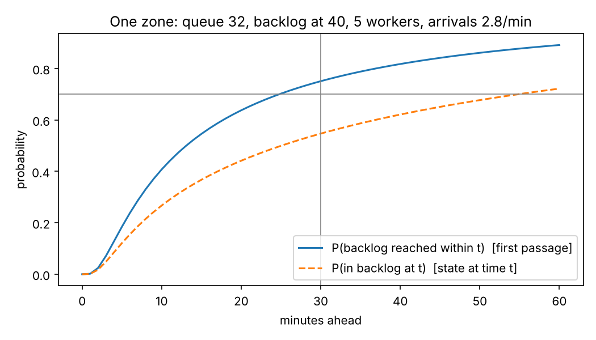
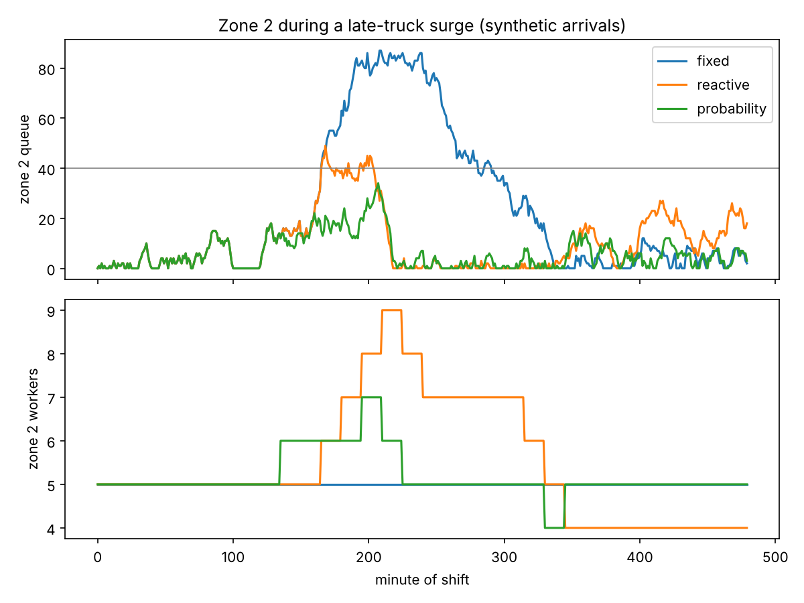

# Probability-Triggered Staff Reallocation in a Multi-Zone Parcel Operation

Working prototype for my final-year project at Loughborough University
(supervisor: Dr Radmehr Monfared). **This is work in progress.** The
README says plainly what runs today and what is still planned.

**Two-page methodology note (PDF):** [docs/Methodology_Note.pdf](docs/Methodology_Note.pdf)

**Appendix A, a fluid model of worker transfers and parcel queues (PDF):** [docs/Appendix_A_Fluid_Model.pdf](docs/Appendix_A_Fluid_Model.pdf)

## Problem

In a parcel or cross-docking operation, volume does not arrive on schedule. A
late truck leaves a zone idle, then its load arrives at once and a backlog
forms. Other zones may have spare staff at the same moment. The question:

> Can a model warn that a zone is about to fall into backlog early enough to
> move a worker there before it happens?

## Model

**One zone as a continuous-time Markov chain.** The queue length `n` is a
birth-death process (M/M/c truncated at K): arrivals at rate λ, service at rate
μ per worker, `c` workers. The generator matrix `Q` has

```
Q[n, n+1] = λ          Q[n, n-1] = μ · min(n, c)          Q[n, n] = −(row sum)
```

**Kolmogorov forward equations.** `dp/dt = p Q`, so `p(t) = p(0) · exp(Q t)`.

**Which probability triggers a move.** Two quantities look similar but are not
the same:

| Quantity | How it is computed | What it answers |
|---|---|---|
| P(in backlog **at** t) | `p(t)` summed over states ≥ B | Will the zone be in backlog at minute 30? |
| P(backlog reached **within** t) | make states ≥ B absorbing, then `p(t)` | Will the zone hit backlog at any point in the next 30 minutes? |

A backlog that forms and clears before minute 30 is missed by the first and
caught by the second, so the second is always at least as large. The trigger
uses the second. In the example below the two lead to different decisions: at
minute 30 the "at" probability is 0.55 (below the 70% trigger) while the
"within" probability is 0.75 (above it).



**Decision rule.** Every 15 minutes, for each zone, compute
P(backlog within 30 minutes) at the current queue and arrival rate.

- Above **70%**: the zone asks for a worker.
- Below **30%**: the zone may lend one, and a borrowed worker goes home.
- The gap between 70% and 30% stops workers being moved back and forth.
- A small **integer programme** (`scipy.optimize.milp`) chooses which donor
  sends a worker to which receiver, keeping every zone at a minimum staffing
  level.

## What runs today

| Component | Status |
|---|---|
| Generator matrix and forward equations for one zone | Implemented, tested |
| First-passage (absorbing-state) probability | Implemented, tested |
| Four-zone minute-by-minute simulation | Implemented |
| Policies: fixed, reactive (queue threshold), probability-triggered | Implemented |
| Integer programme for donor-receiver moves | Implemented (small assignment ILP) |
| Arrival rates | **Synthetic** late-truck pattern; loader for an hourly profile included |
| Calibration on the CROSSStacks cross-docking dataset | **Planned** |
| Sensitivity analysis of the 70%/30% thresholds and review interval | **Planned** |
| Non-exponential service times | **Planned** (current model assumes exponential) |
| Coupling between zones (moves change other zones' rates) | **Planned**; zones are forecast separately |

## Illustrative output (synthetic arrivals, 200 simulated shifts)



| Policy | Mean zone-minutes in backlog | Mean worst queue | Mean staff moves |
|---|---|---|---|
| Fixed | 284.3 | 123.3 | 0.0 |
| Reactive | 142.5 | 78.0 | 16.5 |
| Probability-triggered | 43.0 | 55.5 | 13.0 |

These numbers come from a synthetic arrival pattern chosen to contain late-truck
surges. They show that the pipeline works end to end. **They are not evidence
about a real facility** and should not be quoted as results until the model is
calibrated on real data and its thresholds tested.

## Known limitations

- Exponential service times (the CTMC requires them).
- Each zone is forecast on its own; moving a worker changes the other zones too.
- Arrival rate is held constant over the 30-minute forecast window.
- Thresholds are set by hand, not derived as optimal.

## Run it

```bash
python -m pip install -r requirements.txt
python -m pytest -q       # 4 tests
python run_demo.py        # regenerates results/ (about 1 minute)
```

## Structure

```text
src/staffing/ctmc.py       generator, forward equations, first-passage probability
src/staffing/simulate.py   four-zone simulation, policies, integer programme
tests/test_model.py        unit tests
run_demo.py                figures and policy comparison
results/                   output
```

## Reference

Xu, Liu and Montreuil (2022), dynamic workforce scheduling and relocation across
hyperconnected parcel logistic hubs, Proceedings of the IISE Annual Conference.
Their rolling-horizon re-planning between hubs is the starting point; this
project applies a probability trigger to moves inside one site.

## Development note

The code was written with AI coding assistance. The problem, model design and
assumptions are from my project work; I have reviewed and run every part.
